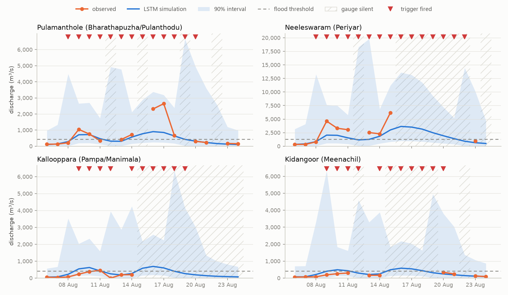

# Kerala, August 2018

The worst flooding in Kerala in a century peaked on 15-17 August 2018. This replays VARUNA's decision chain (`python -m varuna.pipeline.hindcast`) for each day and every CAMELS-IND gauge in the affected rivers: the regional LSTM simulates flow from the day's rain, the conformal predictive distribution gives a 90% interval and P(flood), and the RiskEngine fires when P(flood) reaches the cut-off chosen on 1981-1990. Flood threshold: the gauge's 99th percentile of 1991-2015 flow. None of 2018 was used for training or tuning; the rain is the observed rain (a perfect forecast).

## Each gauge, 6-24 August

| gauge                                   | silent on 14-20 Aug   |   observed flood days |   trigger fired on them |   fired on observed non-flood days | first trigger   | highest reading      | simulated peak       |
|:----------------------------------------|:----------------------|----------------------:|------------------------:|-----------------------------------:|:----------------|:---------------------|:---------------------|
| Arangaly (Periyar/Chalakudy)            | 5 of 7 days           |                     8 |                       4 |                                  0 | 09 Aug          | 1,881 m3/s on 15 Aug | 1,167 m3/s on 16 Aug |
| Kalampur (Muvattupuzha/Kaliyar)         | 6 of 7 days           |                     0 |                       0 |                                  6 | 08 Aug          | 264 m3/s on 10 Aug   | 387 m3/s on 16 Aug   |
| Kallooppara (Pampa/Manimala)            | 6 of 7 days           |                     1 |                       1 |                                  4 | 09 Aug          | 462 m3/s on 11 Aug   | 690 m3/s on 16 Aug   |
| Kidangoor (Meenachil)                   | 5 of 7 days           |                     0 |                       0 |                                  5 | 09 Aug          | 345 m3/s on 20 Aug   | 583 m3/s on 16 Aug   |
| Neeleswaram (Periyar)                   | 5 of 7 days           |                     6 |                       6 |                                  1 | 08 Aug          | 6,166 m3/s on 15 Aug | 3,645 m3/s on 16 Aug |
| Pulamanthole (Bharathapuzha/Pulanthodu) | 2 of 7 days           |                     6 |                       6 |                                  4 | 08 Aug          | 2,641 m3/s on 17 Aug | 904 m3/s on 16 Aug   |
| Ramamangalam (Muvattupuzha)             | 6 of 7 days           |                     1 |                       1 |                                  5 | 08 Aug          | 737 m3/s on 11 Aug   | 1,141 m3/s on 16 Aug |

## Pulamanthole (Bharathapuzha/Pulanthodu), the one gauge that recorded the peak (threshold 427 m3/s)

| date   |   3-day rain (mm) | observed (m3/s)   |   simulated (m3/s) | 90% interval   |   P(flood) | trigger   |
|:-------|------------------:|:------------------|-------------------:|:---------------|-----------:|:----------|
| 06 Aug |                 8 | 121               |                103 | 10-972         |       0.02 |           |
| 07 Aug |                25 | 130               |                141 | 14-1,331       |       0.04 |           |
| 08 Aug |                68 | 214               |                286 | 18-4,489       |       0.16 | fires     |
| 09 Aug |               213 | 1,043             |                710 | 190-2,650      |       0.73 | fires     |
| 10 Aug |               239 | 753               |                723 | 193-2,697      |       0.74 | fires     |
| 11 Aug |               198 | 342               |                467 | 125-1,744      |       0.5  | fires     |
| 12 Aug |                54 | no reading        |                313 | 19-4,921       |       0.19 | fires     |
| 13 Aug |                31 | 416               |                304 | 19-4,776       |       0.18 | fires     |
| 14 Aug |               110 | 728               |                567 | 152-2,117      |       0.62 | fires     |
| 15 Aug |               176 | no reading        |                772 | 207-2,882      |       0.76 | fires     |
| 16 Aug |               341 | 2,315             |                904 | 242-3,374      |       0.81 | fires     |
| 17 Aug |               292 | 2,641             |                853 | 228-3,182      |       0.79 | fires     |
| 18 Aug |               226 | 668               |                639 | 171-2,384      |       0.69 | fires     |
| 19 Aug |                45 | no reading        |                424 | 27-6,664       |       0.36 | fires     |
| 20 Aug |                20 | 300               |                313 | 19-4,922       |       0.19 | fires     |
| 21 Aug |                16 | 232               |                229 | 14-3,600       |       0.09 |           |
| 22 Aug |                13 | no reading        |                164 | 10-2,586       |       0.04 |           |
| 23 Aug |                 5 | 171               |                127 | 13-1,200       |       0.03 |           |
| 24 Aug |                 3 | 154               |                104 | 11-982         |       0.02 |           |
